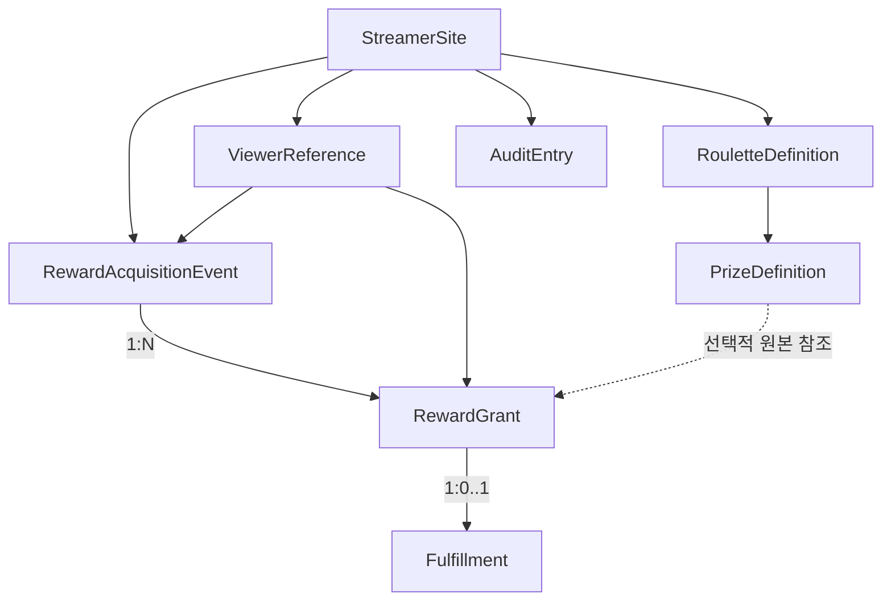

# receipts.gg (가제) — 애그리거트 및 도메인 규칙 설계

- **버전:** 0.2
- **개정일:** 2026-10-13
- **상태:** 설계 기준선 초안
- **참조:** `PRD.md`, `DOMAIN_MODEL.md`, `SOFTWARE_ARCHITECTURE.md`, `docs/adr/ADR-0003-postgres-consistency.md`

## 1. 애그리거트 설계 원칙

1. 애그리거트는 도메인 불변식을 지키는 경계이며, 반드시 단일 테이블이나 DB 트랜잭션 하나를 의미하지 않는다.
2. 다른 애그리거트를 식별자(ID)로 참조한다.
3. 사건에 연결된 보상 3개를 생성할 때는 여러 애그리거트를 한 DB 트랜잭션으로 저장할 수 있다.
4. 보상 권리의 유효성과 이행 상태는 `RewardGrant`가 관리한다.
5. 보상 권리 무효화와 단순 제작 지연을 혼동하지 않는다.

## 2. 애그리거트 목록

| 애그리거트 루트 | 소유 요소 | 주요 불변식 |
|---|---|---|
| `StreamerSite` | 사이트 설정 | 사이트 고유성·소유 경계 |
| `RouletteDefinition` | `PrizeDefinition` | 보상 정보·공개 상태, 과거 기록 보존 |
| `ViewerReference` | 표시명·선택적 외부 식별자 | 닉네임만으로 자동 병합 금지 |
| `RewardAcquisitionEvent` | 사건 출처 정보 | 발생 근거·출처·발생/기록 시각 분리 |
| **`RewardGrant`** | `Fulfillment`(0..1) | 권리 유효성 및 이행 일관성 |

`AuditEntry`는 개별 기록으로 보존한다. CMS의 공지·일정 편집 애그리거트는 CMS 상세 설계에서 추가 정의하며 RMS의 일관성 경계 안에 넣지 않는다.

## 3. 핵심 객체 관계

- 룰렛 없이 `MANUAL_AWARD` 사건을 기록할 수 있다.
- PrizeDefinition 비활성화 후에도 Grant의 `prizeNameSnapshot`과 `fulfillmentRequiredSnapshot`은 보존된다.
- MVP에서 사건 1건은 최소 Grant 1개를 생성한다.

## 4. RewardGrant 불변식

- 하나의 Grant는 보상 **1단위**를 나타낸다.
- RewardGrant는 `ACTIVE` 또는 `VOIDED` 상태이다.
- `fulfillmentRequiredSnapshot=true`라면 유효 Grant에 Fulfillment 하나가 있다.
- `fulfillmentRequiredSnapshot=false`라면 이행 작업을 만들지 않는다.
- `ACTIVE` 상태의 유효한 미이행 보상을 임의로 취소해 지급 의무를 삭제할 수 없다.
- 이미 실제 이행 완료된 보상은 완료 처리 정정 없이 무효화할 수 없다.
- Grant와 Fulfillment를 변경하는 명령은 항상 같은 Root를 통해 실행한다.
- 다른 사이트의 룰렛·시청자·사건을 연결할 수 없다.

## 5. 상태 전이 정책

### 5.1 RewardGrant

| 현재 | 명령 | 이후 | 조건 |
|---|---|---|---|
| ACTIVE | `voidErroneousGrant(reason)` | VOIDED | 오기록·중복 등 정정 사유 필수, Fulfillment 미완료 |
| VOIDED | 일반 상태 변경 | 거부 | MVP 재활성화 미지원 |

### 5.2 Fulfillment

| 현재 | 명령 | 이후 | 비고 |
|---|---|---|---|
| PENDING | `start()` | IN_PROGRESS | 정상 |
| PENDING | `complete()` | FULFILLED | 직접 완료 가능 |
| IN_PROGRESS | `complete()` | FULFILLED | 정상 |
| FULFILLED | `correctCompletion(reason)` | IN_PROGRESS | 관리자 정정, 사유·감사 필요 |
| PENDING/IN_PROGRESS | Grant의 `voidErroneousGrant(reason)` | CANCELLED | 독립 명령 아님 |
| CANCELLED | 일반 상태 변경 | 거부 | 정정 정책 후속 검토 |

`FULFILLED`일 때 `fulfilledAt`을 보존한다. 완료를 정정하면 현재 완료 시각을 해제할 수 있으나, 과거 완료 시각과 사유는 AuditEntry에 남긴다. 정당한 보상 제작 지연은 IN_PROGRESS/PENDING 상태를 유지한다.

## 6. 트랜잭션 설계

### TX-001 — 보상 등록(원자적)

1. ADMIN의 사이트 권한을 확인한다.
2. `idempotency_key`와 요청 본문 해시를 확인한다.
3. 같은 사이트의 시청자 참조·룰렛·보상 유효성을 확인한다.
4. RewardAcquisitionEvent 1건을 저장한다.
5. 보상 수량만큼 RewardGrant를 생성한다.
6. 이행 필요 보상만 Fulfillment를 생성한다.
7. AuditEntry 및 멱등성 결과를 저장한다.
8. 한 PostgreSQL 트랜잭션으로 커밋한다.

어느 단계라도 실패하면 사건·Grant·Fulfillment·Audit·멱등성 결과가 불완전하게 남지 않아야 한다.

### TX-002 — 개별 보상 이행 완료

1. Grant와 버전을 조회한다.
2. `ACTIVE` 여부 및 이행 전이 조건을 검증한다.
3. Fulfillment 상태와 완료 시각을 변경한다.
4. **Grant 루트 버전도 증가**시킨다.
5. AuditEntry를 쓰고 커밋한다.

### TX-003 — 완료 정정

1. 기존 `FULFILLED`와 요청 버전을 확인한다.
2. 관리자에게 사유를 요구한다.
3. 현재 Fulfillment를 `IN_PROGRESS`로 정정한다.
4. Grant 루트 버전을 증가시키고 과거 완료 기록을 AuditEntry에 기록한다.
5. 커밋한다.

### TX-004 — 미완료 오기록 무효화

1. Grant `ACTIVE`, Fulfillment `PENDING/IN_PROGRESS`(또는 이행 불필요)인지 확인한다.
2. 무효화 사유를 필수 입력받는다.
3. Grant를 `VOIDED`, 존재하는 미완료 Fulfillment를 `CANCELLED`로 변경한다.
4. 루트 버전을 증가시키고 AuditEntry를 기록한다.
5. 커밋한다.

Fulfillment가 없는 이행 불필요 보상은 Grant만 VOIDED로 변경한다. 이미 완료된 Grant를 바로 무효화하려는 요청은 거부한다.

## 7. 멱등성·동시성·격리

- **수동 등록 요청 키:** `(site_id, idempotency_key)` 유일성. 같은 키·동일 본문이면 기존 결과, 같은 키·다른 본문이면 충돌.
- **외부 이벤트 식별:** 외부 ID가 있을 때 `(site_id, external_system, external_event_id)` 유일성. 외부 ID가 없으면 임의의 내용 비교만으로 중복 판정하지 않는다.
- **낙관적 동시성:** Grant의 `version`을 검증한다. 자식 Fulfillment만 저장하는 UPDATE로 루트 버전 검사가 누락되지 않도록 한다.
- **사이트 격리:** 모든 연관 객체가 같은 사이트 소유인지 검증하고 필요한 DB 참조 제약을 둔다.
- **재시도:** 동시 처리 중 동일 키 재전송은 DB 고유 제약·트랜잭션 격리 하에서 기존 결과 반환 또는 충돌 후 안전한 재조회로 처리한다.

## 8. 공개 집계의 수학적 일관성

- `valid_grants` = Grant 상태 ACTIVE인 수
- `pending` = ACTIVE Grant 중 Fulfillment PENDING인 수
- `in_progress` = ACTIVE Grant 중 Fulfillment IN_PROGRESS인 수
- `fulfilled` = ACTIVE Grant 중 Fulfillment FULFILLED인 수
- `no_fulfillment_required` = ACTIVE Grant 중 Fulfillment가 없는 수
- `outstanding` = pending + in_progress

`valid_grants = pending + in_progress + fulfilled + no_fulfillment_required`를 유지한다(초기 도메인 모델의 유효 상태 기준). VOIDED와 CANCELLED는 유효 합계에서 제외한다.

공개 집계는 전체 데이터가 아니라 **공개 허용된 Grant 집합**에 같은 규칙을 적용한다. 비공개 건수 자체도 공개하지 않는다.

## 9. 이전 미결정 사항 Q-001~Q-005

| 질문 | 결정 | MVP 구현 여부 |
|---|---|---|
| Q-001 과거 업보 | `LEGACY_IMPORT` 사건 유형, 미상 발생일 허용 | 데이터 모델만 준비, CSV는 P1 |
| Q-002 복합 보상 | 독립 이행 단위별 Grant; 복합품 자동 분해하지 않음 | 단순 방식 P0 |
| Q-003 취소 | 정당한 지연과 오기록 무효화 분리 | P0 |
| Q-004 닉네임 | 내부 ID, 자동 병합 금지 | P0 |
| Q-005 교환 | 추후 교환 사건으로 출처 연결 | P1 |

## 10. 핵심 자동화 테스트

| 테스트 | 기대 결과 |
|---|---|
| 방셀 3장 획득 | Event 1, Grant 3, Fulfillment 3 |
| 1장만 완료 | 완료 1, 미이행 2 |
| 신규 등록 트랜잭션 중 실패 | 사건과 보상 일부만 남지 않음 |
| 중복 키 재전송 | 추가 생성 0 |
| 동일 키·다른 내용 | 충돌 |
| Fulfillment 직접 CANCELLED 요청 | 거부 |
| 미완료 오기록 권리 무효화 | VOIDED/CANCELLED 및 Audit 원자 저장 |
| 이미 완료된 권리 무효화 | 정정 선행하지 않으면 거부 |
| 다른 관리자 오래된 버전 저장 | 409 충돌 |
| 보상 정의 변경 | 기존 Grant 스냅샷 유지 |
| 즉시 지급 Grant | Fulfillment 없음, outstanding 불변 |
| 다른 사이트 참조 | 거부 |
| PUBLIC 조회 | 개별 공개 허용 Grant만 반환 |

## 11. 후속 설계에서 결정할 내용

- CMS 콘텐츠 애그리거트와 임시저장·게시 정책
- 데이터베이스 스키마·인덱스·테이블 단위 제약
- 시청자 참조 수동 병합 및 이관 시 중복 처리(P1)
- 개인정보 보존·삭제 정책
- 외부 연동 재처리·장애 감지 정책(P1 이상)
