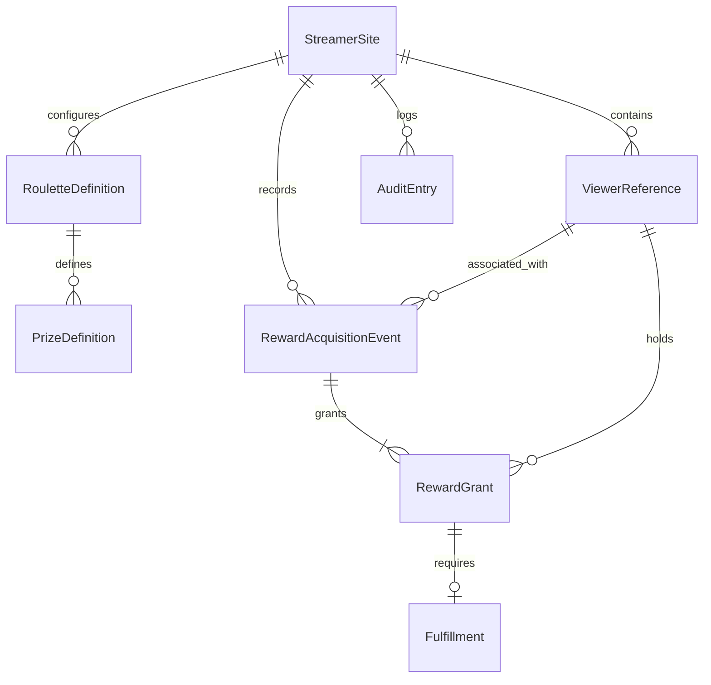
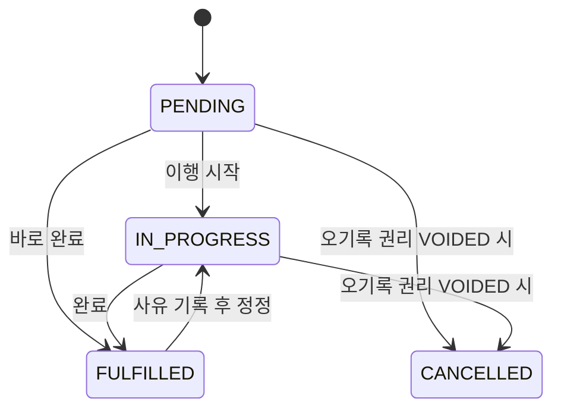

# receipts.gg (가제) — 도메인 모델 및 유스케이스

- **버전:** 0.2
- **개정일:** 2026-10-13
- **상태:** 설계 기준선 초안
- **상위 문서:** `PRD.md`
- **애그리거트·정정 정책:** `AGGREGATE_DESIGN.md`를 우선 참조

## 1. 설계 범위와 이름

본 문서는 CMS·RMS·인증·감사 기록에 사용되는 도메인 언어와 모델을 정의한다. `receipts.gg`는 제품 가제이다. `StreamerSite`는 고객 스트리머의 개별 사이트로, 제품명·인터넷 도메인과 동일한 개념이 아니다. DB 스키마와 API 구조는 SA 단계에서 결정한다.

## 2. 유비쿼터스 언어

| 한국어 | 모델 | 의미 |
|---|---|---|
| 스트리머 사이트 | `StreamerSite` | 고객 스트리머의 공개 페이지·운영 데이터 소유 경계 |
| 관리자 | `Admin` | 허가된 사이트 데이터를 수정하는 인증 사용자 |
| 시청자 참조 | `ViewerReference` | 계정 소유권 인증과 별개인 운영상 수령자 식별 |
| 룰렛 정의 | `RouletteDefinition` | 안내용 룰렛 구성 |
| 보상 정의 | `PrizeDefinition` | 룰렛의 현재 보상 항목·확률 |
| 보상 획득 사건 | `RewardAcquisitionEvent` | 룰렛 당첨·직접 지급·이관 같은 발생 근거 |
| 획득 보상 권리 | `RewardGrant` | 시청자가 획득한 개별 보상 1단위 |
| 업보 이행 | `Fulfillment` | 실제 제작·전달 등 이행 작업 |
| 감사 기록 | `AuditEntry` | 관리자에 의한 주요 변경의 추적 기록 |

**폐기된 이름:** `DrawEvent`는 기존 문서의 초기 용어이며, 신규 문서와 구현에서는 **`RewardAcquisitionEvent`로 통일**한다.

## 3. 모델별 역할

### 3.1 StreamerSite

- 속성 후보: `siteId`, `slug`, `displayName`, `description`, `themeConfiguration`, `publicationStatus`.
- 데이터 소유 경계 제공; 하나의 사이트를 MVP에서 운영하더라도 `site_id`로 구분한다.
- `slug`는 스트리머 사이트 경로 식별자 후보이고 제품 가제 `receipts.gg`와 다르다.

### 3.2 Admin

- 관리자 계정과 허용 사이트를 연결한다.
- 서버 인증 및 사이트 권한이 있어야 변경 작업을 수행한다.
- 공개 시청자 계정과는 무관하다.

### 3.3 ViewerReference

- 속성 후보: `viewerId`, `siteId`, `displayNickname`, `platform`, `externalUserId?`, `createdAt`.
- 닉네임이 같아도 동일 시청자라고 가정하지 않는다.
- 외부 계정 ID를 알지 못할 수 있으며, 검색 기능은 소유권 인증을 대신하지 않는다.
- 공개 표시명과 관리자 내부 식별자를 분리한다.

### 3.4 RouletteDefinition / PrizeDefinition

- RouletteDefinition: `rouletteId`, `siteId`, `name`, `description`, `publicationStatus`.
- PrizeDefinition: `prizeId`, `rouletteId`, `name`, `description`, `probability?`, `fulfillmentRequired`, `activeStatus`.
- 현재 보상 정의가 바뀌어도 획득 당시의 이름·이행 필요 여부는 RewardGrant에 스냅샷으로 보존한다.
- 수동 입력 확률은 외부 룰렛 추첨 엔진을 자동 검증한 결과가 아니다.

### 3.5 RewardAcquisitionEvent

- 속성 후보: `eventId`, `siteId`, `viewerId`, `rouletteId?`, `eventType`, `sourceType`, `occurredAt?`, `recordedAt`, `externalSystem?`, `externalEventId?`, `idempotencyKey?`.
- **eventType:** `ROULETTE_DRAW`, `MANUAL_AWARD`, `LEGACY_IMPORT`.
- **sourceType:** `MANUAL`, `CSV_IMPORT`, `INTEGRATION`.
- 실제 발생 시각을 모르면 `occurredAt`을 미상으로 두고 기록 시각만 보존한다.
- 하나의 사건은 MVP에서 1개 이상의 RewardGrant를 낳는다. `꽝` 사건의 저장은 MVP 제외.
- 과거 수동 룰렛 당첨은 `eventType=ROULETTE_DRAW`, `sourceType=MANUAL`로 표현할 수 있다.

### 3.6 RewardGrant

- 속성 후보: `grantId`, `siteId`, `eventId`, `viewerId`, `prizeId?`, `prizeNameSnapshot`, `fulfillmentRequiredSnapshot`, `grantStatus`, `publicVisibility`, `version`, `grantedAt`.
- **상태:** `ACTIVE` 또는 `VOIDED`.
- 보상 1단위마다 하나의 Grant를 생성한다. 방셀 3장은 Grant 3개다.
- 이행 필요 보상에는 하나의 Fulfillment가 있으며, 즉시 지급 보상에는 없을 수 있다.
- RewardGrant가 Fulfillment의 변경과 보상 권리 유효성 규칙을 책임진다.

### 3.7 Fulfillment

- 속성 후보: `fulfillmentId`, `grantId`, `status`, `requestedOption?`, `privateNote?`, `createdAt`, `startedAt?`, `fulfilledAt?`, `cancellationReason?`.
- **상태:** `PENDING`, `IN_PROGRESS`, `FULFILLED`, `CANCELLED`.
- `CANCELLED`는 **오기록 보상 권리를 VOIDED 처리할 때 연결된 미완료 이행 작업에만 사용**한다.
- 정당한 보상의 제작 지연은 `PENDING` 또는 `IN_PROGRESS`를 유지한다.

### 3.8 AuditEntry

- 속성 후보: `auditId`, `siteId`, `actorId`, `actionType`, `targetType`, `targetId`, `previousState`, `nextState`, `reason?`, `occurredAt`.
- 주요 변경과 같은 트랜잭션으로 저장한다. 일반 ADMIN 화면에서 임의 수정하지 못하도록 한다.
- 개인정보 삭제·보존 관련 규정은 별도 정책으로 관리한다.

## 4. 도메인 관계

`PrizeDefinition`과 `RewardGrant`는 선택적으로 출처 참조를 가지며, 현재 보상 정의 삭제·변경으로 과거 Grant가 수정되지 않는다. 모든 교차 참조는 같은 `site_id` 범위에서 유효해야 한다.

## 5. 도메인 불변식

1. 하나의 Grant는 개별 보상 1단위를 나타낸다.
2. 모든 Grant는 하나의 RewardAcquisitionEvent에 연결된다.
3. `fulfillmentRequiredSnapshot=true`인 ACTIVE Grant에는 Fulfillment가 정확히 하나 있어야 한다.
4. Fulfillment가 없는 즉시 지급 보상은 **미이행에 포함하지 않는다**.
5. `FULFILLED`에는 완료 시각이 있고, 정정 시 변경 이력이 남는다.
6. Fulfillment를 독립 명령으로 CANCELLED로 변경할 수 없다. CANCELLED는 오기록 권리 무효화(`voidErroneousGrant`)의 결과로만 발생한다.
7. 오기록 미완료 Grant 무효화는 `ACTIVE → VOIDED`와 `Fulfillment → CANCELLED`를 원자적으로 기록한다.
8. 완료된 보상은 완료 상태의 별도 정정 없이 무효화할 수 없다.
9. PUBLIC 응답에는 개별 공개 허용 정보만 포함하며 관리자 메모·내부 식별자를 반환하지 않는다.
10. 등록 요청의 멱등성 키는 사이트별 유일하게 관리하고 본문을 함께 검증한다.
11. RewardGrant 버전 충돌을 검증하며 Fulfillment 변경 시에도 루트 버전을 갱신한다.
12. 도메인 참조와 권한은 사이트 간에 격리된다.

## 6. 이행 상태 전이

완료 정정 및 무효화는 일반 상태 변경보다 강화된 검증과 감사 기록을 요구한다. `CANCELLED`를 운영자의 단순한 '취소' 버튼으로 제공하지 않는다.

## 7. 핵심 유스케이스

| ID | 행위자 | 결과 |
|---|---|---|
| UC-001 | ADMIN | CMS 수정·게시로 Public 콘텐츠 반영 |
| UC-002 | ADMIN | 룰렛 및 보상 정의 등록·공개 설정 |
| UC-003 | ADMIN | 한 획득 사건으로 복수 Grant·Fulfillment 원자적 생성 |
| UC-004 | ADMIN | Grant 하나의 Fulfillment 완료, 다른 Grant 유지 |
| UC-005 | ADMIN | 완료 기록을 사유와 함께 정정하고 Audit 보존 |
| UC-006 | PUBLIC | 공개 허용된 업보만 조회·검색 |
| UC-007 | ADMIN/연동 | 동일 요청의 멱등 처리·중복 이벤트 방지 |
| UC-008 | ADMIN | 외부에서 확인한 보상 옵션을 기록하고 공개 범위를 유지 |
| UC-009 | ADMIN | 미완료 오기록 Grant 무효화 및 Fulfillment 취소 |

## 8. 기존 Q-001~Q-005 결론

- **Q-001(과거 업보):** `LEGACY_IMPORT` 사건 유형 사용. CSV 기능은 P1.
- **Q-002(복합 보상):** 독립 이행 가능한 단위로 Grant를 구분. 자동 구성품 분해는 MVP 제외.
- **Q-003(권리 무효화):** 이행 지연과 오기록 무효화를 구분. 미완료 오기록만 원자적으로 VOIDED/CANCELLED.
- **Q-004(닉네임 중복):** 내부 ID 우선. 동일 닉네임 자동 병합 금지.
- **Q-005(보상 교환):** 교환 사건과 전후 권리 연결 모델은 P1에서 검토. MVP 제외.

정식 애그리거트 경계, 동시성·원자성 정책은 `AGGREGATE_DESIGN.md`를 참조한다.

## 9. 미구현 범위

실시간 SOOP 채팅 수집, 위플랩 자동 이벤트, 시청자 제재, 시청자 로그인·본인 인증, 보상 양도·교환, 일반 사용자 셀프 온보딩은 MVP 범위에서 제외한다.
