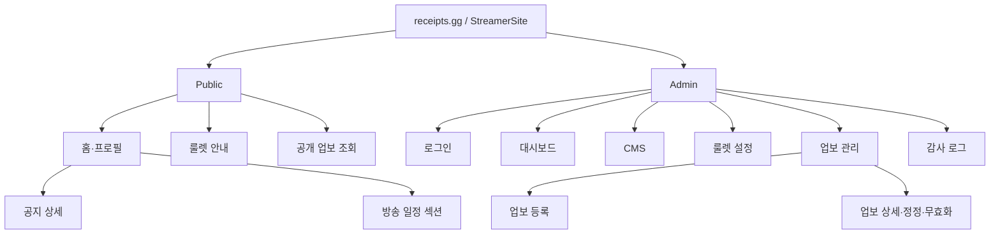

# receipts.gg (가제) — IA 및 User Flow

- **버전:** 0.2
- **개정일:** 2026-10-13
- **상태:** 정보 구조·업무 흐름 설계 기준선
- **참조:** `PRD.md`, `DOMAIN_MODEL.md`, `AGGREGATE_DESIGN.md`, `WIREFRAMES.md`

## 1. 정보 구조 원칙

- **PUBLIC:** 스트리머의 소개와 방송 정보에 빠르게 접근하고, 허용된 룰렛·업보 데이터를 탐색하는 비로그인 경험.
- **ADMIN:** CMS 편집과 보상 등록·이행·정정을 빠르게 완료하는 인증된 운영 경험.
- `receipts.gg`는 제품 가제, 각 고객의 `StreamerSite`는 별개 개념이다.
- 페이지 표시 여부는 서버의 공개 정책에 의해 최종 결정된다.
- PUBLIC은 계정이 없으므로 닉네임 검색으로 보상을 수정하거나 소유권을 주장할 수 없다.

## 2. 사이트맵

## 3. 화면 목록 및 책임

| ID | 화면 | 사용 권한 | 핵심 업무 | PRD 추적 |
|---|---|---|---|---|
| PUB-001 | 홈·프로필 | PUBLIC | 캐릭터·소개·SOOP 링크·일정·공지 | FR-001 |
| PUB-002 | 룰렛 안내 | PUBLIC | 공개 룰렛 보상·수동 확률 안내 | FR-003 |
| PUB-003 | 업보 조회 | PUBLIC | 공개 보상 검색·필터·상태 확인 | FR-006 |
| PUB-004 | 공지 상세 | PUBLIC | 게시된 공지만 읽기 | FR-001, FR-002 |
| ADM-001 | 로그인 | ADMIN 인증 이전 | 서버 세션 시작 | FR-007 |
| ADM-002 | 대시보드 | ADMIN | 집계·빠른 업보 등록 | FR-009 |
| ADM-003 | CMS | ADMIN | 프로필·이미지·링크·일정·공지 편집 | FR-002 |
| ADM-004 | 룰렛 관리 | ADMIN | 정의·보상·확률·공개 관리 | FR-003 |
| ADM-005 | 업보 등록 | ADMIN | 획득 사건과 복수 Grant 등록 | FR-004 |
| ADM-006 | 업보 관리·상세 | ADMIN | 이행 완료·정정·오기록 무효화 | FR-005 |
| ADM-007 | 감사 로그 | ADMIN | 변경 이력 검색·상세 | FR-008 |

MVP에서 방송 일정은 홈의 섹션이며 독립 페이지는 필수가 아니다. 공개 프로필·일정은 저장 시 반영, 공지는 초안·게시를 구분한다.

## 4. 핵심 사용자 흐름

### FLOW-001 — 팬이 스트리머 정보 탐색

1. Public 홈에 접속한다.
2. 캐릭터·소개·SOOP 방송국 링크를 본다.
3. 일정·공지·룰렛·업보 메뉴로 이동한다.
4. 로그인 없이 공개 정보를 조회한다.

### FLOW-002 — 관리자가 홈페이지 수정

1. 로그인 → ADM-002 → ADM-003으로 이동한다.
2. 수정 항목을 선택하고 내용을 입력한다.
3. 서버 검증 후 저장/게시를 수행한다.
4. 공개 사이트에서 반영 결과를 확인한다.
5. 오류 시 폼 내용은 유지하고 원인을 안내한다.

### FLOW-003 — 관리자 보상 획득 등록

1. 대시보드에서 `새 업보 등록`을 선택한다.
2. 시청자 참조를 확인·선택한다(닉네임 중복 시 관리자 구분).
3. 사건 유형과 선택적 룰렛·보상·수량을 입력한다.
4. 보상별 이행 필요·공개 여부를 확인한다(기본 비공개).
5. 제출 시 중복 요청 키와 원자성을 검증한다.
6. Event 1건과 Grant N개, 필요한 Fulfillment를 등록하고 결과를 표시한다.

### FLOW-004 — 관리자 업보 완료

1. 업보 목록에서 미이행 건을 찾는다.
2. Grant 하나를 선택한다.
3. 이행 시작 또는 완료를 요청한다.
4. 서버가 상태와 버전을 확인한다.
5. 변경·감사 로그를 저장하고 목록·집계를 갱신한다.

### FLOW-005 — 관리자가 잘못된 완료를 정정

1. FULFILLED Grant를 연다.
2. `완료 기록 정정`을 선택하고 사유를 입력한다.
3. 서버가 버전 및 전이 규칙을 검증한다.
4. 상태를 IN_PROGRESS로 정정하고 변경 이력을 남긴다.

### FLOW-006 — 관리자 오기록 무효화

1. 아직 미완료이거나 이행 불필요인 ACTIVE Grant를 선택한다.
2. 일반 상태 변경 메뉴가 아닌 `오기록 무효화`를 선택한다.
3. 영향 범위 및 사유를 확인하고 최종 제출한다.
4. Grant VOIDED 및 존재하는 미완료 Fulfillment CANCELLED를 원자적으로 처리한다.
5. 완료된 보상인 경우 정정 절차가 먼저 필요하다는 오류를 보여준다.

### FLOW-007 — 방문자 공개 업보 조회

1. PUBLIC 업보 페이지에서 닉네임·상태·보상 종류로 검색한다.
2. 공개 허용 Grant만 조회한다.
3. 대기·이행 중·완료·이행 불필요를 혼동하지 않고 표시한다.
4. 본인 인증 또는 보상 옵션 수정 기능은 제공하지 않는다.

## 5. 공통 UI 상태

- Loading: 제출 중 중복 클릭 방지, 아직 성공으로 간주하지 않음
- Empty: 룰렛·업보·검색 결과 없음 표시
- Error: 오류 유형과 재시도 가능 여부 표시
- Unauthorized: 관리자 로그인 요구
- Forbidden: 권한이 없는 사이트 접근 거부
- Conflict: 오래된 버전·중복 키 본문 충돌 안내
- Success: 서버 커밋 성공 후 결과 표시

## 6. 공개 정책 및 데이터 일관성

- 새 Grant는 기본 비공개다. 공개 설정을 한 정보만 PUBLIC에서 접근 가능하다.
- PUBLIC의 응답 모델은 ADMIN의 응답 모델과 별도로 정의한다.
- 미이행 수량은 ACTIVE Grant의 `PENDING + IN_PROGRESS` Fulfillment이며 즉시 지급(이행 불필요)은 제외한다.
- PUBLIC 집계는 전체가 아닌 **공개 허용 데이터**만 집계한다.
- 캐싱으로 과거 상태가 잘못 표시되지 않도록 서버 요청/재검증 정책을 둔다.
- 모든 ADMIN 데이터 변경은 권한·CSRF·버전 검증을 거친다.

## 7. 다음 단계

`WIREFRAMES.md`에서 각 화면 배치, 모바일 동작, 등록·정정 다이얼로그 및 예외 상태를 구체화한다. 디자인 시스템이나 구현 컴포넌트는 아직 확정하지 않는다.
