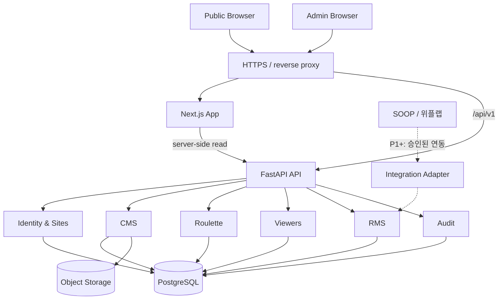

# receipts.gg (가제) — Software Architecture

- **버전:** 0.3
- **개정일:** 2026-10-13
- **상태:** Proposed Architecture Baseline
- **개정 내역:** 0.3 — §7 오류 정책 보완(409 범위 확장, 429 추가, 404 숨김 정책, ADR-0008 참조)
- **참조:** `PRD.md`, `DOMAIN_MODEL.md`, `AGGREGATE_DESIGN.md`, `IA_USER_FLOW.md`, `WIREFRAMES.md`, `adr/`

> `receipts.gg`는 제품 가제이다. 해당 도메인의 소유·DNS 구성·실제 접속 가능 여부는 미확인이다. 여기서 URL은 실제 호스팅을 보장하지 않는다.

## 1. 목표 및 제약

**목표:** 한 스트리머용 브랜딩 홈페이지와 관리자 CMS, 수동 RMS를 실제 배포·테스트할 수 있는 제품으로 만든다. 향후 같은 코드베이스를 재사용하되 지금은 SaaS 온보딩·과금·실시간 채팅 수집을 구축하지 않는다.

**우선순위:** 데이터 정합성 → 인증·개인정보 → 테스트 용이성 → 운영·복구 → UX·성능 → 확장성.

**제약:** 1인 개발, Python 백엔드 역량 증명, 낮은 운영 비용, 외부 비공식 API에 핵심 기능을 의존하지 않음.

## 2. 선택된 기술 및 아키텍처

| 계층 | 제안 기술 | 책임 |
|---|---|---|
| Web | Next.js App Router + TypeScript | Public SSR, Admin UI, 접근성 |
| API | FastAPI + Pydantic | 요청·응답, 인증·인가, 유스케이스 진입 |
| 도메인/응용 | Python | 애그리거트, 상태 전이, 트랜잭션 조정 |
| DB | PostgreSQL + SQLAlchemy + Alembic | ACID, 제약, 낙관적 버전, 마이그레이션 |
| 이미지 | S3 호환 Object Storage | 이미지 바이너리 보관 |
| 패키지 관리 | uv / JS lockfile | 의존성 재현 |
| 품질 | Ruff, pytest, HTTPX, Vitest, Playwright | 린트·도메인/통합/E2E 테스트 |
| 로컬 실행 | Docker Compose | PostgreSQL 재현 가능 환경 |
| 배포 | HTTPS + 웹 서버 + API + 관리형 DB | 단일 사이트 파일럿 운영 |

중요한 라이브러리 버전은 초기 개발 환경 구성 시 호환성을 검증한 뒤 lockfile로 고정한다. Python 3.14 사용 여부도 실제 패키지 호환성을 확인한 후 결정한다.

**스타일:** 모듈러 모놀리스. FastAPI 단일 배포 단위, PostgreSQL 단일 운영 DB. Redis/Kafka/Celery/Kubernetes/MSA는 MVP에서 제외한다.

## 3. 전체 시스템

**배포 오리진:** 브라우저에는 가능한 한 하나의 HTTPS 오리진으로 웹페이지와 `/api/v1`을 제공한다. Next.js의 서버 측 API 요청과 브라우저 요청 모두 쿠키·캐시·인증 경계를 명확히 통제한다.

## 4. 백엔드 모듈 경계

| 모듈 | 책임 | 금지·비책임 |
|---|---|---|
| Identity | 관리자 로그인·세션·권한 확인 | PUBLIC 시청자 로그인 제공하지 않음 |
| Sites | StreamerSite 및 site_id 문맥 | 제품명과 site_slug 혼동 금지 |
| CMS | 프로필·이미지·링크·일정·공지·게시 | RMS 상태 직접 변경 금지 |
| Roulette | 룰렛·PrizeDefinition·확률표 관리 | 자체 추첨 엔진 아님 |
| Viewers | ViewerReference 생성·조회 | 닉네임으로 자동 본인확인 금지 |
| RMS | Event·Grant·Fulfillment·정정·무효화·공개 조회 | 외부 API 응답 구조 직접 의존 금지 |
| Audit | 관리자 주요 변경의 감사 기록 | 일반 사용자의 변경·삭제 허용 금지 |
| Integrations (P1+) | 외부 데이터를 내부 명령으로 변환 | MVP 동작 필수 의존성 아님 |

모듈 간 내부 HTTP 호출을 만들지 않고 Application Interface를 통해 같은 프로세스 내에서 호출한다. 서로 다른 모듈의 ORM/Repository를 무분별하게 직접 참조하지 않는다.

## 5. 계층 분리

- **Presentation:** FastAPI Router, Request/Response 모델, 인증·인가 의존성, HTTP 오류 변환.
- **Application:** 명령/조회 유스케이스, 트랜잭션·멱등성 조정, 도메인 호출.
- **Domain:** Entity, Aggregate, Value Object, 상태 전이·불변식, 도메인 예외.
- **Infrastructure:** DB Repository/Unit of Work, 세션 저장, 이미지 스토리지, 외부 어댑터.

작은 모듈에 형식적인 인터페이스를 기계적으로 늘리지 않는다. 백엔드가 업무 규칙의 최종 실행 위치다.

## 6. 데이터 및 거래 일관성

### 6.1 논리적 저장 개체

`StreamerSite`, `AdminUser`, `AdminSitePermission`, `Session`, `Profile`, `SocialLink`, `ScheduleEntry`, `Notice`, `RouletteDefinition`, `PrizeDefinition`, `ViewerReference`, `RewardAcquisitionEvent`, `RewardGrant`, `Fulfillment`, `AuditEntry`, `IdempotencyRecord`, `MediaAsset`.

논리적 개체 목록이며 최종 테이블명이나 수를 확정한 것은 아니다.

### 6.2 획득 사건 원자적 처리

사건 1개 → RewardGrant N개 → 필요 시 Fulfillment M개 → AuditEntry와 멱등성 기록을 **단일 PostgreSQL 트랜잭션**으로 처리한다. 중도 실패 시 모든 변경을 롤백한다.

### 6.3 권리·이행 상태

- Grant: `ACTIVE` 또는 `VOIDED`.
- Fulfillment: `PENDING`, `IN_PROGRESS`, `FULFILLED`, `CANCELLED`.
- `CANCELLED`는 독립 작업이 아니며 오기록 미완료 Grant를 VOIDED 처리할 때만 연동한다.
- 제작 지연은 여전히 PENDING/IN_PROGRESS.
- 완료 기록의 정정은 이유와 감사 이력을 보존한다.
- 이행 불필요 Grant에는 Fulfillment가 없을 수 있다.

### 6.4 멱등성

- 수동 명령: `(site_id, idempotency_key)` 유일, 요청 본문 fingerprint 일치 검증.
- 동일 키·동일 본문: 기존 결과 반환.
- 동일 키·다른 본문: 409 Conflict.
- 외부 이벤트 ID가 있는 경우 `(site_id, external_system, external_event_id)`의 고유성으로 중복 수신 방지.

### 6.5 동시성

RewardGrant `version` 필드와 업데이트 시 버전 조건을 사용한다. **Fulfillment만 변경해도 Grant 루트 버전을 반드시 증가**시킨다. 낙관적 충돌 시 409를 반환하며 무조건 덮어쓰지 않는다.

### 6.6 시각·집계·격리

- UTC 저장, Asia/Seoul 표시.
- `occurred_at`(알려진 실제 시각)과 `recorded_at`(기록 시각) 분리.
- 미이행 수 = ACTIVE Grant 중 Fulfillment PENDING/IN_PROGRESS.
- 완료 수 = ACTIVE Grant 중 Fulfillment FULFILLED.
- 이행 불필요 수 = ACTIVE Grant 중 Fulfillment 없음.
- 공개 목록/집계는 `public_visibility=true`인 데이터만 사용한다.
- Admin API는 권한에 따른 사이트 범위를 강제하고 임의의 `site_id` 파라미터를 신뢰하지 않는다. DB 참조 제약도 추가한다.

## 7. API 설계 원칙

기본 접두사 `/api/v1`. Public과 Admin 응답 모델을 분리하고, 공개 데이터에 관리자 내부 필드를 담지 않는다.

**Public 예시**
- `GET /api/v1/public/site`
- `GET /api/v1/public/notices`
- `GET /api/v1/public/roulettes`
- `GET /api/v1/public/rewards`

**Admin 예시**
- `POST /api/v1/admin/auth/login`
- `POST /api/v1/admin/auth/logout`
- `GET /api/v1/admin/dashboard`
- `POST /api/v1/admin/reward-acquisitions`
- `GET /api/v1/admin/rewards`
- `PATCH /api/v1/admin/rewards/{grantId}/fulfillment`
- `POST /api/v1/admin/rewards/{grantId}/correct-completion`
- `POST /api/v1/admin/rewards/{grantId}/void`
- `GET /api/v1/admin/audit`

API 후보이며 세부 요청·응답·오류 계약은 후속 명세에서 확정한다.

**오류 정책:** 401 미인증, 403 금지된 동작(CSRF·Origin 검증 실패 등), 404 조회 없음 **또는 권한 없는 리소스 숨김**, 409 멱등성 충돌·낙관적 버전 충돌·**도메인 상태 전이 위반**, 422 입력 검증 실패, **429 요청 속도 제한**, 500 서버 오류.

응답 본문은 RFC 9457 Problem Details 형식을 사용하고 안정적인 기계 식별자 `code`를 포함한다. 도메인 예외는 HTTP를 모르며 Presentation 계층의 중앙 매핑 테이블에서 상태 코드로 변환한다. 상세 계약과 근거는 **ADR-0008**을 따른다.

인증된 관리자의 허용 사이트를 벗어난 리소스는 403이 아니라 404로 응답해 존재 여부를 숨긴다(ADR-0005). 예외에 내부 SQL·세션 비밀값·스택트레이스를 노출하지 않는다. OpenAPI를 계약 소스로 유지하며, 실제 응답과의 일치를 테스트로 확인한다.

## 8. 인증·인가·개인정보

- Public 무로그인, ADMIN은 서버 세션 로그인.
- 세션 쿠키는 Secure/HttpOnly/SameSite, 서버 측 로그아웃·만료 처리.
- 상태 변경 요청에 CSRF 토큰과 Origin 검사를 적용한다.
- 비밀번호 해시, 로그인 속도 제한, 최소권한, 민감정보 로그 제외.
- 공개 Grant는 기본 비공개. 별도 Public 응답 스키마 사용.
- 닉네임 검색이 계정 소유권을 증명한다고 표시하지 않는다.
- 이미지 업로드는 형식·크기·실제 콘텐츠 검증과 안전한 URL 처리를 적용한다.
- 감사 로그 보존은 개인정보 보존·삭제 의무와 함께 관리한다.

## 9. Frontend 구성 및 캐시

하나의 Next.js 웹 앱에서 Public Layout과 Admin Layout을 분리한다. Public 페이지는 서버 렌더링 중심, 검색·필터와 ADMIN 폼은 Client Component로 구성한다.

- 게시·공지 등 공개 콘텐츠 캐시는 변경 빈도와 무효화 방법을 명시한다.
- 업보와 집계는 최신성이 필요하므로 보수적 캐시·재검증 정책을 적용한다.
- 인증된 ADMIN API 응답은 공유 캐시에 저장하지 않는다.
- UI가 서버 커밋 전에 성공을 표시하지 않는다.

## 10. 로컬·운영 환경

**Local:** Docker Compose PostgreSQL, `uv` 기반 API, Node/Next.js 웹 앱. 가상 스트리머 및 보상 Seed 제공.

**Test:** 독립 테스트 DB, 마이그레이션 및 통합 테스트 실행.

**Production 제안:** HTTPS, Next.js 서버, FastAPI 서버, 관리형 PostgreSQL, 이미지 Object Storage. 실제 클라우드 사업자 및 `receipts.gg` 도메인 연결은 소유·비용·운영 요구 확인 후 결정한다.

Alembic으로 DB 변경 이력을 관리하고 백업과 복원을 실제 점검한다. 환경 변수·비밀값은 소스 저장소에 포함하지 않는다.

## 11. 테스트 전략

| 수준 | 필수 확인 |
|---|---|
| Domain Unit | 상태 전이·이행 완료 정정·권리 무효화·즉시 지급·보상 수량 |
| Application | 단일 사건/복수 Grant 생성·멱등성·감사 기록 원자성 |
| DB Integration | 실제 PostgreSQL 롤백·고유 제약·낙관적 버전·사이트 격리 |
| API | 401/403/409, 기본 비공개, Public 데이터 누출 방지 |
| Frontend | 폼 유효성, 상태 UI, 공개 접근성 |
| E2E | 로그인 → 룰렛 생성 → 방셀 3장 등록 → 1장 완료 → 공개 반영 → 정정 → 감사 확인 |

**성능:** 테스트 데이터 1만 건, 주요 조회 API p95 500ms는 초기 **목표**이며 배포 인프라·로드 프로필을 기록한 뒤 판단한다.

## 12. CI/CD·관측·복구

- CI: Python lint/format, TypeScript typecheck/lint, 백엔드/프론트 테스트, 빌드 검증.
- 배포: 변경 검증 → DB 백업 확인 → 마이그레이션 → 앱 배포 → 헬스체크 및 주요 API 스모크 테스트.
- 관측: 요청 ID, 오류율, 주요 API 실패, 배포 버전, 헬스체크.
- 복구: DB·이미지 자산 백업 정책과 복원 연습 문서화.
- 운영 로그에 비밀번호·세션 식별자·비공개 업보·배송 정보 등 민감 데이터를 포함하지 않는다.

## 13. 명시적인 비채택 기술

- MSA: MVP에서는 분산 트랜잭션·운영 부담만 증가.
- Redis: PostgreSQL 세션·멱등성 기록으로 시작, 필요 시 도입.
- Kafka/RabbitMQ/Celery: 초기에는 상시 외부 이벤트 수집/비동기 대량 작업이 없음.
- Kubernetes: 작은 단일 배포에 불필요.
- Event Sourcing: 감사 로그와 현재 상태 저장으로 충분.
- 비공식 SOOP/위플랩 프로토콜에 기반한 핵심 기능: 장기 안정성·허용 범위 불확실.

## 14. 기술적 위험과 관리

| 위험 | 대응 |
|---|---|
| 외부 연동 불가 | 수동 RMS를 핵심으로 유지 |
| 중복 지급 | 멱등성 키·DB 유일성 제약 |
| 오래된 화면의 동시 갱신 | Grant 루트 버전 갱신 및 409 |
| 유효 보상 실수로 취소 | 오기록 무효화 전용 명령·사유·감사 |
| 비공개 보상 노출 | 기본 비공개·Public 모델 분리·테스트 |
| 고객마다 구현 분기 증가 | 사이트 데이터·테마 기반 구성 |
| 데이터 손실 | 백업·복원 테스트 |
| 캐싱에 의한 업보 과거 상태 | 최신성 정책·재검증 |

## 15. 개발 선행 조건과 후속 절차

개발 실행 순서와 단계별 완료 기준의 최신 기준은 **`DEVELOPMENT_PLAN.md`**이다. 개발자 결정에 따라 **백엔드 우선(Backend First)**으로 진행한다.

1. BE-00: Monorepo/백엔드 개발 환경 초기화 및 헬스체크.
2. BE-01~02: PostgreSQL 스키마·사이트 참조 제약, 인증·인가 구현.
3. BE-03~04: CMS 및 룰렛 관리 백엔드 API.
4. BE-05~06: RewardGrant 핵심 도메인·API, 공개 장부·집계 API.
5. BE-07: 실제 PostgreSQL 통합 테스트·API 계약·보안 테스트를 포함한 **백엔드 완료 게이트**.
6. **BE-07 완료 및 사용자 승인 후** FE-00~04: Next.js 프론트엔드, 브라우저 E2E 및 반응형 검증.
7. REL-00: 데모 배포, 모니터링·백업·복원 검증.

백엔드 단계에서 OpenAPI/Swagger 및 HTTP 클라이언트로 API를 검증할 수 있으나, **제품 UI 개발은 백엔드 완료 후** 시작한다. 프론트엔드 구현 과정에서 발견되는 API 변경은 계약·테스트·문서와 함께 조정한다.

후속 P1(허용된 외부 연동·CSV·교환), P2(제재 사건 이력), P3(실시간 증거/STT/LLM·SaaS)는 MVP 배포를 막는 선행 조건이 아니다.
